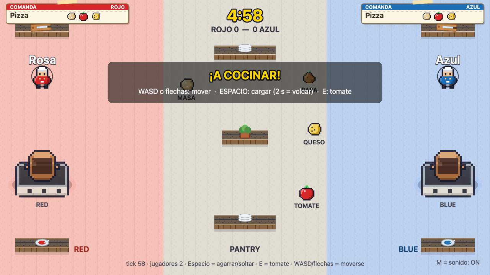

# Guerra de Cocinas

Arcade 2D top-down para **7 jugadores en LAN**: dos equipos (4 vs 3) cocinan platos en su olla y sabotean la del rival. Gana el equipo que más platos sirve en **5 minutos**.



## Cómo se juega

- Cada jugador abre el juego desde su PC, elige un nombre y cae en el lobby.
- El **primero en entrar es el host**; arranca la partida con **Empezar** (mínimo 2 jugadores).
- Los equipos se **sortean al azar** en cada partida (con 7 jugadores: 4 y 3).
- La comanda actual de cada equipo aparece arriba, en una **comanda de papel** con los ingredientes.
- La olla cocina cuando tiene los **3 ingredientes correctos en cualquier orden** (5 s; el equipo con menos jugadores cocina en 4 s).
- Se sirve un plato al completar la cocción. Empate al terminar el tiempo → **muerte súbita**.

### Controles

| Tecla | Acción |
|---|---|
| `WASD` o flechas | Moverse |
| `Espacio` (tap, < 2 s) | Agarrar/soltar ingrediente o aceite, cargar la olla propia, robar de la olla rival, contaminar |
| `Espacio` (hold, ≥ 2 s) | Vaciar la olla propia o volcar la olla rival (con barra de progreso) |
| `E` | Tirar un tomate (aturde 1,5 s, 3 s de enfriamiento) |
| `M` | Silenciar/activar el sonido (persiste entre recargas) |

### Sabotaje

- **Tomatazo:** aturde al rival y le hace soltar lo que lleva. Sin fuego amigo.
- **Robar:** tap en la olla rival mientras no está cocinando (manos vacías).
- **Contaminar:** meter un ingrediente equivocado o repetido en la olla rival (humo verde; no cocina hasta vaciarla).
- **Volcar:** hold 2 s sobre la olla rival mientras cocina.
- **Aceite:** power-up del centro (cada 30 s) que deja un charco resbaladizo.

## Stack

- **Cliente:** [Phaser 4](https://phaser.io/) + Vite, JavaScript ES Modules. Todo el pixel art se genera en runtime.
- **Servidor:** Node + [`ws`](https://github.com/websockets/ws), **autoritativo**, simula a 20 Hz y manda el estado completo.
- **Sin dependencias de arte ni audio externas:** sprites y sonidos (Web Audio API) se sintetizan en código.

## Empezar

Requiere **Node 20+**.

```bash
npm install
npm start
```

`npm start` compila el cliente (`dist/`) y levanta HTTP + WebSocket en el **mismo puerto 3000**. La consola imprime la URL de la LAN:

```
Jugá en:  http://192.168.x.x:3000
```

Abrí esa URL en cada PC de la red y empezá con **Empezar** (≥ 2 jugadores). Con 2 pestañas del mismo navegador también se puede probar.

### Modo desarrollo

```bash
npm run dev          # Vite en :3000 (proxya /ws)
npm run dev:server   # servidor WS en :3001
```

## Scripts

| Comando | Qué hace |
|---|---|
| `npm start` | Build + servidor en un solo puerto (`:3000`) |
| `npm run dev` + `npm run dev:server` | Cliente con HMR + servidor en `:3001` |
| `npm run build` | Sólo compila el cliente a `dist/` |
| `npm test` | Tests unitarios del servidor y de lógica pura (`node --test`) |
| `npx playwright test` | Suite E2E completa (levanta el servidor solo) |
| `node scripts/verify-runtime.mjs` | Chequeo de arranque del runtime |
| `node scripts/validate-architecture.mjs` | Valida EventBus / GameState / constantes / `render_game_to_text()` |

## Arquitectura

```
server/   simulación autoritativa: lobby, partida, ollas, sabotajes (20 Hz)
shared/   constantes y mapa que comparten cliente y servidor
src/      cliente Phaser: escenas, sprites procedurales, audio, UI
tests/    unitarios (node --test) y E2E (Playwright)
docs/     gameplan, stack, milestones, ADRs y backlog
```

- **Servidor autoritativo:** el cliente no simula nada; manda cambios de teclas/acciones y dibuja el estado del servidor, interpolando entre snapshots.
- **`shared/constants.js`** es la única fuente de números del juego; `src/core/Constants.js` agrega los de presentación.
- **EventBus** (pub/sub) y **GameState** (singleton) comunican los módulos del cliente sin imports cruzados.
- **Un puerto:** el servidor sirve `dist/` y el WebSocket en `:3000`.
- **`window.render_game_to_text()`** devuelve un snapshot JSON del estado, útil para tests e inspección.

## Tests

```bash
npm test                # unitarios, rápido
npx playwright test     # E2E: lobby, movimiento, cocina, sabotajes, audio, fin de partida
```

Los E2E levantan el servidor con `ALLOW_TEST_HOOKS=1` (hooks de posicionamiento para no simular caminatas largas).

## Docs

- [`docs/gameplan.md`](docs/gameplan.md) — reglas y loop del juego
- [`docs/tech.md`](docs/tech.md) — stack, convenciones y tooling
- [`docs/milestones/`](docs/milestones/) — trabajo desglosado con criterios de aceptación
- [`docs/architectural-decisions/`](docs/architectural-decisions/) — ADRs (engine/stack, servidor autoritativo)
- [`docs/STATE.md`](docs/STATE.md) — handoff de la última sesión
- [`docs/backlog.md`](docs/backlog.md) — pendientes conocidos

## Alcance

Proyecto pensado para **LAN y escritorio**: sin cuentas, sin persistencia, sin mobile y sin matchmaking online. No exponer el servidor a internet (no tiene autenticación ni rate limiting).

## Licencia

Sin licencia definida: todos los derechos reservados.
